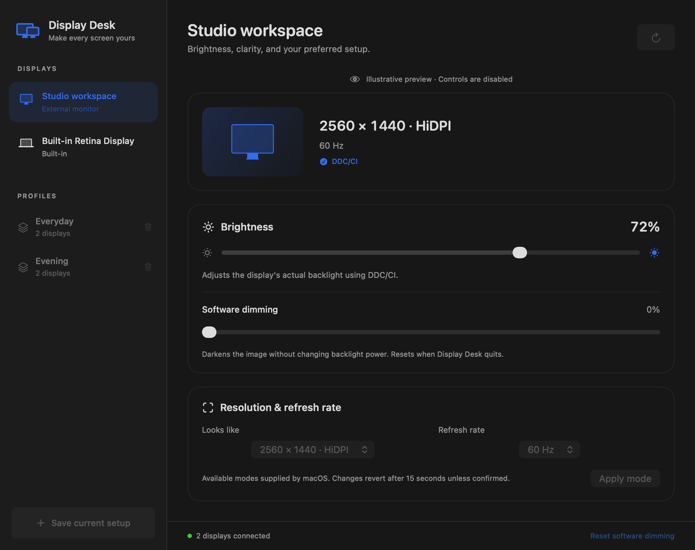

# Display Desk

A standalone native macOS utility for brightness, resolution/refresh rate, and saved display profiles. Inspired by the monitor-management workflow of BetterDisplay, with its own interface and implementation.



The screenshot uses illustrative data. The running app discovers your actual displays.

## What works

- Per-display hardware brightness through Apple display controls or verified DDC/CI on compatible Apple silicon external-monitor connections.
- Separate software dimming for displays without hardware brightness support.
- Resolution/scaling and refresh-rate choices from the modes that macOS exposes, including available HiDPI modes.
- A 15-second keep/revert confirmation for mode and profile changes. Unconfirmed changes restore the previous settings.
- Named profiles capturing all connected displays' modes, brightness, and dimming.
- Profile matching by stable display UUID rather than display order or name; missing monitors or unavailable modes are reported before applying the profile.
- A dashboard, menu bar quick controls, hot-plug/wake refresh, and light/dark appearance.
- RGB display ICC profile selection and import, with a 15-second keep/revert preview and a session-original restore button.
- HDR/SDR switching on displays where macOS exposes it, with verified state and the same keep/revert preview.
- Optional experimental HDR desktop boost: a colour-curve method plus a Metal desktop-rendering alternative for systems that clamp colour curves. Boost stops on quit and can be reset from the menu bar or dashboard.

## Build and run

Requires macOS 26+, Xcode with Swift 6.3 or later, and an internet connection for the initial package dependency fetch. The project was built with Xcode 27 / Swift 6.4.

From this directory:

```sh
./scripts/build-app.sh
open "build/Display Desk.app"
```

The script builds a Release executable, wraps it in a local app bundle, and ad-hoc signs it. Copy `build/Display Desk.app` into Applications to launch it independently of your editor. This is a local development build, not a notarized distribution.

For development, open `Package.swift` in Xcode and select the DisplayDesk executable and My Mac, or run `swift build`.

## Using it

1. Select a display in the sidebar.
2. Use **Brightness** for the actual backlight. If unavailable, enable DDC/CI in your monitor's on-screen menu and check the connection. Software dimming is a separate image-darkening control and does not reduce backlight power.
3. Choose a **Looks like** resolution and refresh rate, then click **Apply mode**. Click **Keep changes** within 15 seconds, or let the app revert.
4. Click **Save current setup** to name a profile. Click a profile in the sidebar to apply it, then keep or revert the changes.
5. Use the menu bar for quick brightness access. **⌥⌘0** resets software dimming while the dashboard is active.

Software dimming resets when the app quits. Display modes are applied for the current macOS login session. Profiles remain saved for later use; they are not automatically applied at login or when a monitor connects.

## Colour and extra brightness

Select an unlocked preset such as **User** in the monitor's own menu before using hardware brightness. The Lenovo Pro 27UD-10's DCI-P3 preset can lock both its physical brightness control and DDC writes. Display Desk cannot bypass that firmware restriction.

Under **Colour & HDR**, choose an installed RGB display ICC profile or import an `.icc`/`.icm` file made for this monitor and its current preset. Imported profiles are copied into Display Desk's Application Support directory. Generic **Display P3** describes an assumed display; it is not a measured calibration and does not reproduce the monitor's factory DCI-P3 gamut clamp. Accurate matching requires a suitable measured profile, typically produced with a colorimeter. This app assigns profiles; it does not measure or automatically calibrate the panel. Colour-managed applications use the selected profile; other applications may behave differently.

HDR mode is a separate switch and can change the monitor's colours. Colour-profile and HDR changes revert after 15 seconds unless kept. **Restore original colour & HDR** previews the settings captured before this app first changed the display during the current run. Kept profile and HDR selections remain active after quitting. Profiles now save colour-profile paths, HDR state, boost level and method; older saved profiles still load without requiring these fields. Move or delete an assigned ICC file and a saved setup using it may no longer apply.

**HDR desktop boost** uses available EDR brightness headroom, with a requested range of 100–200%. It is a multiplier, not measured nits or a guarantee that the panel will get twice as bright. HDR must already be enabled. Reset software dimming to zero first. Boost may alter colour rendering or HDR highlights and is unsuitable for judging calibrated colour or mastering HDR content. It cannot exceed the panel's power, temperature, sustained-brightness or content-dependent limits.

- **Colour curves** scales a captured copy of the display's existing channel curves, then verifies the readback. Values above 1.0 rely on experimental OS behaviour beyond Apple's documented gamma-table range. Some macOS/hardware paths clamp these values; the app restores the original curves and reports failure instead of claiming success. It yields to another app if that app changes the curves.
- **Try Metal boost** uses ScreenCaptureKit to capture only the selected display, excluding its own output window, and renders the desktop into an EDR Metal surface using Display P3. It requires macOS Screen Recording permission, requested only by **Allow Screen Recording…**. Frames stay in memory on this Mac; no audio, microphone, recording files or uploads are used. Protected content may be blank. Capture is tone-mapped to SDR before boosting, so this does not preserve original HDR highlights. It adds GPU work and display latency, renders at up to 60 fps, and is not intended for competitive gaming or colour-critical work. The app refuses to start if it cannot explicitly exclude its output window.

Use **Reset boost & dimming** to remove software adjustments immediately (also **⌥⌘0** while the dashboard is active). Quitting removes active boost windows and restores owned colour-curve adjustments. The app does not repeatedly rewrite curves to fight other display utilities. Disable other apps' colour adjustments before testing boost. macOS may require restarting Display Desk after changing Screen Recording access.

## Hardware support and limits

Apple display brightness uses the MIT-licensed [MacBrightnessKit](https://github.com/taketaku/MacBrightnessKit), pinned to version 0.1.0. The license is included in Resources and copied into the built app. Framebuffer discovery follows the approach documented by [m1ddc](https://github.com/waydabber/m1ddc); its MIT license is included as well.

Generic external brightness uses a separate DDC/CI implementation that resolves the exact OS-provided framebuffer route (with an EDID-validated fallback), then validates brightness replies and packet checksums. Hardware writes are read back; ignored writes are reported and hardware control is marked read-only until Refresh is used. Software dimming remains available. If two identical monitors cannot be uniquely matched, hardware control is disabled rather than sending a command to an uncertain display. Software dimming and mode selection remain available. DDC compatibility depends on the monitor, cable, port, and dock; DisplayLink and some HDMI paths may not support it.

Brightness access uses private Apple interfaces, so this development build runs without App Sandbox. It does not request administrator privileges, install a background helper, or make runtime network requests.

This version covers brightness, exposed display modes, profiles, ICC assignment, HDR switching, and experimental desktop brightness boosting. It does not implement virtual displays, custom HiDPI injection, automatic colour calibration, rotation, mirroring, or EDID overrides. BetterDisplay's branding and proprietary implementation are not included.

## Tests and validation

```sh
swift test
```

Tests cover profile round trips, legacy profile decoding, invalid values, duplicate names, disconnected displays, unsupported modes, EDID validation, DDC reply checksums, ambiguous identical-monitor routing, and preservation/validation of channel curves for HDR boost.

Native detection, brightness read/write at the existing value, profile application/confirmation, and automatic rollback at the existing mode were verified on the development Mac's built-in display. The connected Pro 27UD-10 external monitor was detected through DDC/CI; current-mode profile application and rollback were verified. Its DCI-P3 monitor preset was subsequently identified as locking brightness, including physical controls; an unlocked preset is required.

For the colour/HDR additions, the development monitor passed alternate ICC assignment/readback, 15-second automatic ICC rollback, HDR switching/readback and manual restoration, and SDR boost rejection. The Metal shader compiled and a live local stream started, survived reconciliation, and stopped cleanly. A requested 110% boost was capped at the currently reported 1.0905× EDR headroom. Original SDR state and the original colour profile were restored afterward. The colour-curve boost path was clamped to 1.0 by this macOS configuration and correctly reported failure. Fourteen automated tests pass. Physical luminance and colour accuracy have not been measured; permission availability and Metal output on other displays still require local verification.

## Local data

Profiles live in `~/Library/Application Support/DisplayDesk/profiles.json`. They contain display UUIDs, names, and settings. Keep that file private if you export it; it is not stored in the source repository.

## Structure

```text
Sources/DisplayDesk/           Native UI, display service, and hardware control
Sources/DisplayDeskCore/       Profile models, validation, and DDC protocol helpers
Tests/DisplayDeskCoreTests/    Hardware-independent regression checks
Resources/                    App metadata and third-party license
scripts/build-app.sh          Builds the standalone app bundle
Preview/                      Native renders with illustrative data
```

## Startup

Open **Settings → Startup** to enable launch at login. This uses macOS Login Items and is off by default. Keep the app at a permanent path before enabling it. If macOS requests approval, use **Open Login Items…** to approve the registration. Turning it off unregisters the item; it does not install a helper or change display settings.

## Automatic profiles

In **Settings → Automatic profiles**, choose a saved profile and use it for the currently connected external-monitor setup. Enable automation separately. Rules match the exact external display UUID set, not connection order or display names. Startup and monitor connection changes are considered after discovery settles. Missing profiles, ambiguous rules, or unavailable saved displays/modes are not applied. The app previews changes and opens the dashboard: choose **Keep changes** within 15 seconds, or the previous setup is restored. One attempt is made per topology change; merely refocusing the app does not reapply a rule. Rules are stored locally in `~/Library/Application Support/DisplayDesk/automation.json`; this file contains device identities and should stay private.
